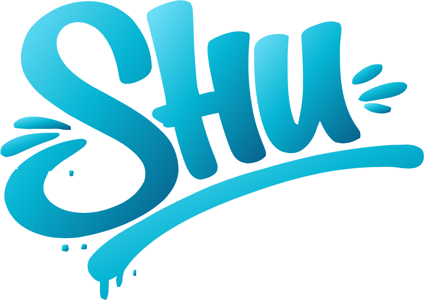
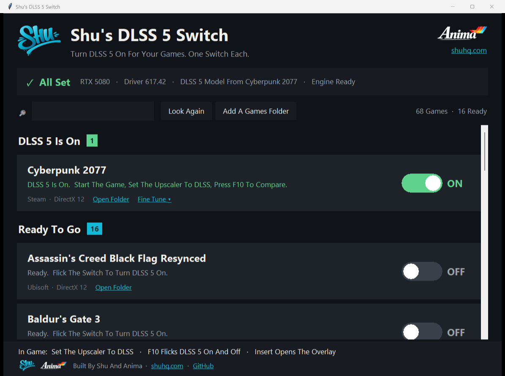
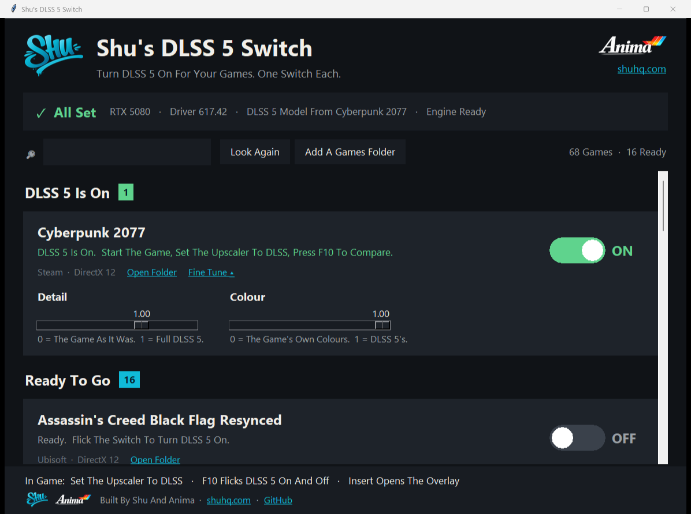

 &nbsp;&nbsp; 

<a href="https://shuhq.com">shuhq.com</a> &nbsp;·&nbsp; <a href="https://x.com/ShuHQcom">@ShuHQcom</a> &nbsp;·&nbsp; <a href="https://github.com/shu2600">More From Shu On GitHub</a>

# Shu's DLSS 5 Switch

**One Switch Per Game. Flick It On And Your Game Gets DLSS 5 Neural Rendering. Flick It Off And The Game Is Exactly As It Was.**

I Wanted DLSS 5 In The Games I Already Own, Without Running A Mystery Exe From A Four-Day-Old Repo Or Downloading NVIDIA Files From Who Knows Where. So We Built The Safe Version: It Looks At Your Games, Tells You Straight Which Ones Can Take DLSS 5 And Which Can't (And Why), And Puts Everything Back When You Turn It Off.

## How It Works

1. Run `setup.bat`. It installs Python if your PC doesn't have it, then opens the Switch.
2. Four Checks Across The Top: Your Graphics Card (RTX 50 Series), Your Driver (616.56 Or Newer), The DLSS 5 Model, And The Engine.
3. Your Games Are Sorted For You Into **On**, **Ready For DLSS 5** And **Can't Run DLSS 5**, Each With A Plain Reason.
4. Flick The Switch On A Ready Game. Launch It, Set The Game's Upscaler To **DLSS**, And You're In.
5. In Game: **F10** Flicks DLSS 5 On And Off So You Can Compare. **Insert** Opens The Overlay, Which Says Why If It Can't Run.
6. Back In The Switch, **Detail** And **Colour** Sliders Tune Each Game.

 Fine Tune: Detail And Colour Per Game

## What Makes It Different

**It Never Ships Or Downloads NVIDIA's Model.** DLSS 5's Model (`nvngx_dlssnr.dll`, About 165 MB) Is NVIDIA's, And It Isn't Ours To Hand Out. The Switch Finds The Copy Already On Your PC, Inside A Game That Ships DLSS 5, Checks NVIDIA's Digital Signature On It, And Refuses Anything That's Been Modified. You Can Also Point It At The File Yourself With **Pick The File**.

**It Leaves Anti-Cheat Games Alone.** Games With Easy Anti-Cheat, BattlEye, EA Javelin, Vanguard And The Rest Are Detected From Their Own Files And Greyed Out. No Override. Kernel Anti-Cheat Runs Even When You're Offline, And A Ban Lands On Your Account, Not The Game.

**Off Means Off.** Every File The Switch Adds Is Written Down. Turning A Game Off Removes Exactly Those Files And Nothing Else. It Never Overwrites Anything That Was Already In Your Game Folder; If Something's In The Way, It Stops And Tells You.

**The Engine Comes From Its Author.** The Switch Downloads Dagherbou's OptiScaler DLSS NR Build From Its Own GitHub Release And Throws It Away Unless Its Fingerprint (SHA-256) Matches The One In The Code. No Rehosted Or Patched Builds.

## What You Need

| | |
|---|---|
| Graphics Card | NVIDIA RTX 50 Series (The Model Doesn't Run On Older Cards) |
| Driver | 616.56 Or Newer |
| DLSS 5 Model | A Game On Your PC That Ships DLSS 5 (For Example NBA 2K27), Or The File From One |
| Games | Single-Player Games That Already Have DLSS, DirectX 11, 12 Or Vulkan |
| Windows | 10 Or 11, Python 3 (setup.bat Installs It) |

## Games

The Switch Works It Out From Each Game's Own Files: Does It Have DLSS, Is There Anti-Cheat, Where Is The Real Exe. `tools/games.json` Holds The Few Games That Need A Nudge (Like Cyberpunk 2077's `bin\x64`) And The Ones That Are Always Blocked.

This Is v1.0 And It's Brand New, So Tell Us How Your Games Go. Open An Issue With The Game, Your Card, And What The Overlay Said, And We'll Add It To The List.

## Good To Know

DLSS 5 Here Runs Through Software NVIDIA Doesn't Officially Support Outside Its Own Games. It Can Look Amazing Or It Can Look Odd; The **Detail** Slider At 0 Gives You The Game As It Was. Read [DISCLAIMER.md](DISCLAIMER.md).

## Credits

Built By Shu And Anima. The Engine Is Dagherbou's [OptiScaler_DLSSNR](https://github.com/Dagherbou/OptiScaler_DLSSNR) (GPL-3.0), Built On [OptiScaler](https://github.com/optiscaler/OptiScaler), With Colour Work From [RenoDX](https://github.com/clshortfuse/renodx). DLSS And NVIDIA Are Trademarks Of NVIDIA Corporation. Full List: [CREDITS.md](CREDITS.md).

More From Us: [shuhq.com](https://shuhq.com) &nbsp;·&nbsp; [Shu's LaunchBox 4K CRT Build](https://github.com/shu2600/shus-launchbox-4k-crt-build) &nbsp;·&nbsp; [Shu's Steam Deck CRT Build](https://github.com/shu2600/shus-steam-deck-crt-build)
